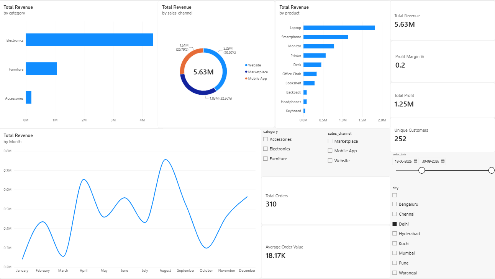

# E-Commerce Sales & Customer Performance Dashboard

An end-to-end data analytics portfolio project using **MySQL, Power BI, and DAX** to analyze e-commerce sales, profitability, product performance, customer segments, cities, and sales channels.

> **Dataset disclosure:** This project uses 3,200 rows of synthetic data created for learning and portfolio demonstration. It does not represent a real company's data.

## Dashboard Preview



## Business Questions

- What are the total revenue, profit, orders, unique customers, and average order value?
- How does revenue change month by month?
- Which product categories and products generate the most revenue?
- Which sales channels contribute most to revenue?
- How do sales vary by city?
- How can users explore performance by category, city, sales channel, and date?

## Tech Stack

- **MySQL** — database and SQL analysis
- **Power BI Desktop** — interactive dashboard and visualization
- **DAX** — calculated measures and KPIs
- **CSV** — synthetic transaction dataset

## Key Performance Indicators

- Total Revenue
- Total Profit
- Total Orders
- Unique Customers
- Average Order Value
- Profit Margin %

## Dashboard Features

- Revenue by product category
- Revenue distribution by sales channel
- Top 10 products by revenue
- Monthly revenue trend
- KPI cards for revenue, profit, orders, customers, and average order value
- Interactive slicers for category, city, sales channel, and order date

## Project Structure

```text
ecommerce_dashboard_project/
├── data/
│   └── ecommerce_sales.csv
├── docs/
│   ├── build_guide.md
│   ├── dataset_profile.json
│   └── ecommerce_dashboard.png
├── powerbi/
│   ├── Ecommerce_Sales_Dashboard.pbix
│   └── DAX_Measures.md
├── sql/
│   └── analysis_queries.sql
└── README.md
```

*File names shown above describe the intended structure. Keep only the entries that match the files actually present in your folders.*

## Setup and Usage

1. Create the database and table using the SQL scripts in the `sql/` folder.
2. Import the synthetic dataset from `data/` if your SQL setup requires a CSV import.
3. Run the SQL analysis queries.
4. Open `powerbi/Ecommerce_Sales_Dashboard.pbix` in Power BI Desktop.
5. If prompted, reconnect the report to your local MySQL database or imported dataset.
6. Use the dashboard slicers to explore the data by category, city, sales channel, and date.

## Skills Demonstrated

- SQL querying and aggregation
- Data analysis and KPI development
- DAX measures
- Interactive dashboard design
- Business-focused data visualization
- Project documentation and version control readiness

## Limitations

The dataset is synthetic. Any trends or metrics shown are illustrative and should not be interpreted as findings from a real business.
